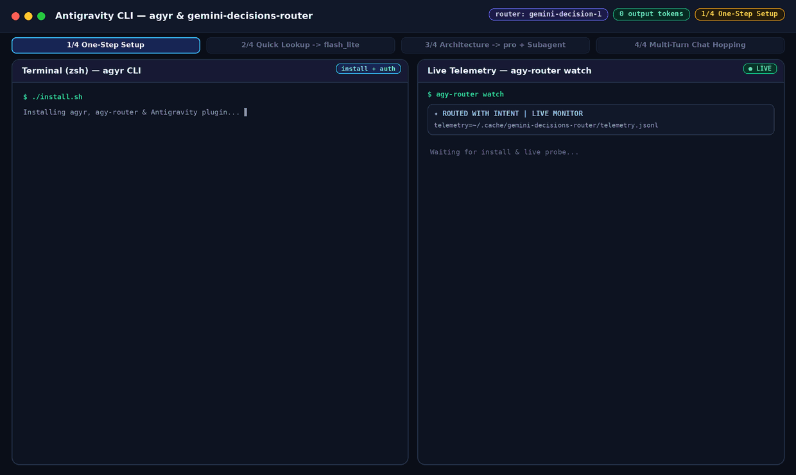
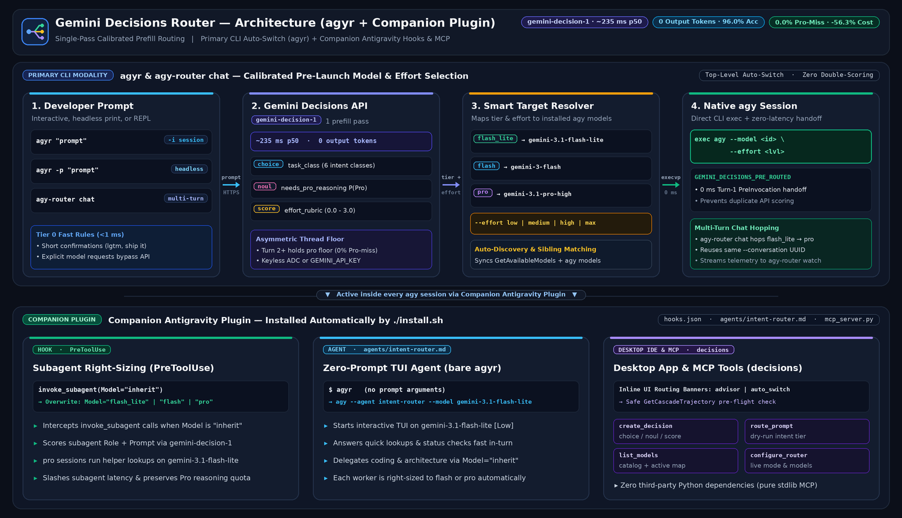

# Gemini Decisions Router for Antigravity

Run `agyr` instead of `agy` to route every prompt in one zero-output-token prefill pass (`~235 ms`) via `gemini-decision-1` before launching Antigravity on the calibrated `--model` and `--effort`. Unlike autoregressive LLM routers that spend `480-1,124 ms` decoding JSON tokens, `gemini-decision-1` scores task intent (`choice`), frontier reasoning need (`noul`), and thinking effort (`score`) directly from prefill posteriors across `flash_lite`, `flash`, and `pro`.



## 30-Second Quickstart

### 1. Install `agyr` and the Companion Plugin

```bash
git clone https://github.com/YOUR_ORG/gemini-decisions-router.git
cd gemini-decisions-router && ./install.sh
```

### 2. Configure Authentication (`GEMINI_API_KEY` or Keyless GCP ADC)

```bash
export GEMINI_API_KEY="your-ai-studio-api-key"
agy-router auth-setup --from-env --auth-mode auto
agy-router auth-check --live
```

Prefer keyless Google Cloud OAuth2 (`gemini_adc` or `vertex_adc`)? Follow the 3-command setup in [docs/AUTHENTICATION_ADC.md](docs/AUTHENTICATION_ADC.md).

### 3. Run `agyr` Instead of `agy`

```bash
agyr "Refactor this FastAPI endpoint and add unit tests"   # Interactive TUI on routed model + effort
agyr -p "What HTTP status code means Too Many Requests?"   # One-shot print mode
agyr                                                       # Bare TUI (intent-router agent)
agy-router chat                                            # Multi-turn REPL that switches models per turn
```

## Architecture: How `agyr` & the Plugin Work Together



**`agyr`** scores top-level CLI prompts before `agy` starts - working seamlessly for `agyr "prompt"`, `agyr -p "prompt"`, and `agy-router chat` - and passes `GEMINI_DECISIONS_PRE_ROUTED` so Turn 1 never double-scores. Running `./install.sh` also installs the companion **Antigravity Plugin** automatically under the hood to unlock three lifecycle capabilities:

1. **Subagent Right-Sizing (`PreToolUse`):** Intercepts `invoke_subagent` calls when `Model` is unset or `"inherit"` so an active `pro` session automatically dispatches simple file lookups on `flash_lite` (`flash_lite` / `flash` / `pro`).
2. **Zero-Prompt TUI (`agyr` with no args):** Launches `agents/intent-router.md` inside the native `agy` TUI on `flash_lite` (`--effort low`) to answer quick questions immediately in-turn while delegating multi-file coding and architecture work to right-sized subagents.
3. **Desktop App Banners & MCP Tools:** Renders zero-token `"✦ Routed with Intent"` cards in the Antigravity Desktop App (`advisor` and `auto_switch` modes) and exposes `create_decision`, `route_prompt`, `list_models`, and `configure_router` MCP tools.

See [docs/ARCHITECTURE.md](docs/ARCHITECTURE.md) for Mermaid sequence diagrams, Asymmetric Thread Floor behavior, dynamic model discovery, and MCP schemas.

## Command Cheat Sheet

| Command | What It Does |
| :--- | :--- |
| `agyr "prompt"` | Score prompt via `gemini-decision-1` and launch interactive `agy -i` on the calibrated `--model` and `--effort` |
| `agyr` | Launch native `agy` TUI with `intent-router` (`flash_lite` in-turn + `PreToolUse`-routed subagents) |
| `agyr -p "prompt"` | Run one-shot headless print mode (`agy -p`) on the calibrated `--model` and `--effort` |
| `agy-router chat` | Multi-turn terminal REPL that re-scores every turn and switches CLI models on one `--conversation` |
| `agy-router sync-models --apply-recommended` | Auto-discover installed Antigravity / `agy models` and persist recommended `flash_lite` / `flash` / `pro` targets |
| `agy-router watch` | Stream live `SWITCH`, `ADVISE`, and subagent routing telemetry in a side terminal |
| `agy-router stats` | Summarize historical tier distribution, mean routing latency, and recent decisions |
| `agy-router set-verbosity compact` | Set inline banner verbosity (`silent`, `compact`, `normal`, `verbose`) |

## Benchmark Highlights (`N=100` Live Evaluation)

Evaluated live against `generativelanguage.googleapis.com/v1beta` across 100 stratified engineering and agentic prompts (`N=15` multi-tier E2E completions):

| Router Strategy | Router `p50` | Output Tokens | Tier Accuracy | Critical Pro-Miss | 100-Prompt E2E Time & Cost |
| :--- | :---: | :---: | :---: | :---: | :---: |
| **Gemini Decisions Router (`gemini-decision-1`)** | **`235 ms`** *(Tier 0+1: `278 ms`)* | **`0`** | **`96.0%`** | **`0.0%`** (`0/30`) | **`-29.1%` time / `-56.3%` cost** |
| **`gemini-3.1-flash-lite` JSON Router (`thinking=0`)** | `709 ms` (`3.0x` slower) | `20.7` | `93.0%` | `10.0%` (`3/30`) | `-21.2%` time / `-57.0%` cost |
| **Offline Lexical Baseline** | `0.01 ms` | `0` | `79.0%` | `36.7%` (`11/30`) | N/A *(36.7% Pro-miss)* |
| **Always-Pro Baseline** | `0 ms` | `0` | `30.0%` | `0.0%` *(70% over-routed)* | `473.2 s` / `$0.515` *(baseline)* |

Verbalized JSON routers collapsed `100/100` confidence scores into `[0.90, 1.00]` (`0.943` mean confidence when wrong) and dropped Turn 2+ `pro` continuations (`"yes go ahead"`), whereas `gemini-decision-1` populated all `4/4` calibration bins (`Brier = 0.0524`). Full methodology, charts, and framework comparisons: [docs/BENCHMARKS.md](docs/BENCHMARKS.md).

## Documentation & Reference Map

- **[docs/ARCHITECTURE.md](docs/ARCHITECTURE.md):** End-to-end architecture, Mermaid sequence diagrams, `GEMINI_DECISIONS_PRE_ROUTED` handoff, dynamic model discovery, and MCP tool schemas.
- **[docs/API_KEY_QUICKSTART.md](docs/API_KEY_QUICKSTART.md):** 5-minute `GEMINI_API_KEY` onboarding (`0600` `.env` setup, `agyr` workflows, live `watch` monitor, and `sync-models`).
- **[docs/AUTHENTICATION_ADC.md](docs/AUTHENTICATION_ADC.md):** Keyless Google Cloud OAuth2 Application Default Credentials (`gemini_adc` and `vertex_adc`) and workstation/GCE/GKE setup.
- **[docs/CUSTOMER_ONBOARDING.md](docs/CUSTOMER_ONBOARDING.md):** Enterprise Google Cloud rollout, IAM roles, VPC Service Controls, and regional Vertex AI endpoints.
- **[docs/BENCHMARKS.md](docs/BENCHMARKS.md):** Live `N=100` accuracy, `flash-lite` & `flash` head-to-head study, 4-bin calibration analysis, and streaming benchmark commands.
- **[docs/TESTING_STRATEGY.md](docs/TESTING_STRATEGY.md):** Target model catalog, security/permission invariants, multi-step deduplication, and `GetCascadeTrajectory` anti-hang tests.
- **[rules/AGENTS.md](rules/AGENTS.md):** Contributor engineering guide, pure-stdlib hermeticity contracts, and TDD workflow.

> **Note:** Do not add `gemini-decision-1` to Antigravity's interactive chat dropdown in `settings.json`; decision models answer `CreateDecision` requests with calibrated probabilities and intentionally return zero text tokens on `GenerateContent` chat calls.

### Verification & License

```bash
python3 -m pytest -v tests/test_external_plugin.py
agy plugin validate . --strict
```

Licensed under the Apache License 2.0. See [LICENSE](LICENSE).
