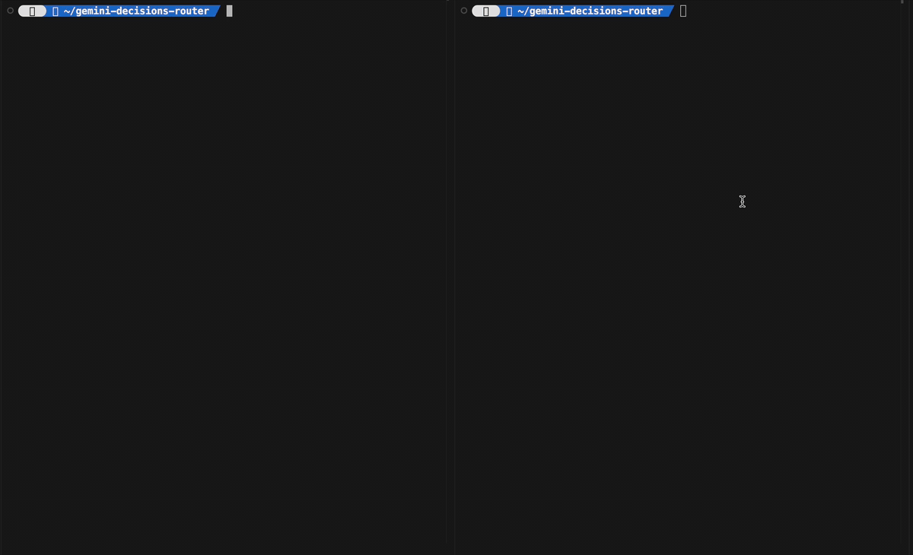

# 5-Minute `GEMINI_API_KEY` Quickstart

Get `agyr` and the companion **Gemini Decisions Router** plugin running in under 5 minutes using a Google AI Studio `GEMINI_API_KEY`.

> **Using Google Cloud instead of an API key?** See [AUTHENTICATION_ADC.md](AUTHENTICATION_ADC.md) for keyless OAuth2 Application Default Credentials (`gemini_adc` and `vertex_adc`).

## Step 1: Install `agyr` and the Companion Plugin (`./install.sh`)

Clone the repository and run `./install.sh` (requires Python 3.11+, zero `pip` packages):

```bash
git clone https://github.com/YOUR_ORG/gemini-decisions-router.git
cd gemini-decisions-router
chmod +x install.sh
./install.sh
```

`./install.sh` sets up everything in one pass:
- Installs `~/.local/bin/agyr` (routed `agy` launcher) and `~/.local/bin/agy-router` (router CLI and multi-turn REPL). Make sure `~/.local/bin` is on your `PATH`.
- Installs the companion Antigravity plugin (`plugin.json`, `hooks.json`, `mcp_config.json`, `agents/intent-router.md`, `rules/AGENTS.md`, and `skills/gemini-decisions-router/SKILL.md`) into `~/.gemini/config/plugins/gemini-decisions-router`.
- Runs `agy plugin validate ~/.gemini/config/plugins/gemini-decisions-router --strict` when `agy` is installed.

Reload the Antigravity Desktop App if it is currently open so it picks up the hooks and MCP server.

## Step 2: Save Your `GEMINI_API_KEY` (`auth-setup`)

Desktop GUI launchers on macOS and Linux often start the Antigravity Desktop App without sourcing `~/.bashrc` or `~/.zshrc`. Running `agy-router auth-setup` writes a `0600`-permissioned `~/.config/gemini-decisions-router/.env` file (`0700` parent directory, symlinks and group/world-readable files rejected) so both **`agyr` / `agy` CLI** and the **Antigravity Desktop App** authenticate reliably:

```bash
# Option A: Import GEMINI_API_KEY from your current shell
export GEMINI_API_KEY="your-ai-studio-api-key"
agy-router auth-setup --from-env --auth-mode auto

# Option B: Pipe via stdin so the key never touches shell history
printf '%s\n' 'your-ai-studio-api-key' | agy-router auth-setup --api-key-stdin --auth-mode auto
```

Verify credential resolution and run a live 1-question prefill probe (`0` output tokens) against `gemini-decision-1`:

```bash
agy-router auth-check --live
```

Expected output (`ok: true` in `~200-250 ms`):

```json
{
  "ok": true,
  "auth_mode": "api_key",
  "model": "gemini-decision-1",
  "project_id": "(from ADC)",
  "location": "global",
  "credential_source": "env:GEMINI_API_KEY",
  "endpoint": "https://generativelanguage.googleapis.com/v1beta/decisions",
  "live_probe": {
    "backend": "gemini_api",
    "latency_ms": 218,
    "answer": {
      "type": "noul",
      "noul": 0.9859,
      "value": true,
      "confidence": 0.9859
    }
  }
}
```

> **Security note:** Process environment variables always override `.env` entries. Never place `GEMINI_API_KEY` inside `config.json` or `router_config.json`; `decisions_engine.py` rejects JSON files containing embedded secrets.

## Step 3: Use `agyr` Instead of `agy`

`agyr` scores your prompt via `gemini-decision-1` before starting `agy`, selects the best installed CLI `--model` and sibling `--effort` (`low`, `medium`, `high`, `max`), and passes `GEMINI_DECISIONS_PRE_ROUTED` so Turn 1 never scores twice:

```bash
# 1. Interactive TUI (-i): launches agy on calibrated --model and --effort
agyr "Refactor this FastAPI endpoint to validate pagination parameters and add unit tests"

# 2. One-shot print mode (-p): routes quick lookups to flash_lite and hard bugs to pro
agyr -p "What HTTP status code means Too Many Requests?"
agyr -p "Design a lock-free ring buffer memory ordering proof in C++20"

# 3. Bare TUI (no prompt): launches agy --agent intent-router on flash_lite (--effort low)
#    Answers quick lookups in-turn and right-sizes delegated subagents via PreToolUse
agyr

# 4. Multi-turn model-hopping REPL: re-scores each turn on the same --conversation
#    (/new resets the thread, /exit quits, --conversation <id> resumes an existing chat)
agy-router chat
```

Inspect a routing plan without launching `agy` or pass an explicit `--model` straight through untouched:

```bash
agyr --dry-run -p "What HTTP status code means Too Many Requests?"
agyr --model gemini-3-flash -p "Summarize git status"
```

## Step 4: Watch Live Telemetry & Sync Models (`watch` & `sync-models`)

Open a side terminal while working in `agyr` or the Antigravity Desktop App to watch live routing events, view summary statistics, or sync newly released models:

```bash
# Stream live SWITCH, ADVISE, and PreToolUse subagent events
agy-router watch

# Summarize historical tier distribution, average latency, and recent prompts
agy-router stats

# Auto-discover installed Antigravity / agy models and apply recommended tier mappings
agy-router sync-models --apply-recommended
agy-router list-models --refresh

# Customize inline banner verbosity (silent | compact | normal | verbose) or Desktop App mode
agy-router set-verbosity compact
agy-router set-mode advisor
agy-router set-mode auto_switch --min-confidence 0.55
```

## Demo & Next Steps



- **[ARCHITECTURE.md](ARCHITECTURE.md):** Mermaid architecture and sequence diagrams, Asymmetric Thread Floor, `GEMINI_DECISIONS_PRE_ROUTED` handoff, and MCP tool schemas (`create_decision`, `route_prompt`, `list_models`, `configure_router`).
- **[AUTHENTICATION_ADC.md](AUTHENTICATION_ADC.md):** Keyless Google Cloud OAuth2 setup (`gemini_adc` and `vertex_adc`).
- **[BENCHMARKS.md](BENCHMARKS.md):** Live `N=100` head-to-head latency, accuracy, and calibration benchmarks.
