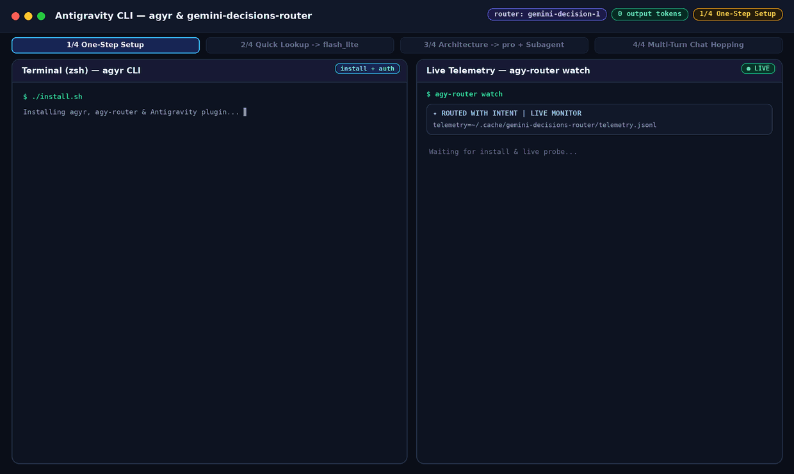

# Gemini API Key Quickstart & Router Operations Guide

This guide walks through installing **Gemini Decisions Router**, configuring `0600` private credentials so both the **Antigravity Desktop App** and **`agy` CLI** authenticate reliably, viewing live routing banners and telemetry, and operating all CLI and MCP tools.

## 1. Frictionless Installation (`./install.sh`)

Clone the repository and run `./install.sh` (requires Python 3.11+):

```bash
git clone https://github.com/YOUR_ORG/gemini-decisions-router.git
cd gemini-decisions-router
chmod +x install.sh
./install.sh
```

What `./install.sh` sets up automatically:
- Copies `plugin.json`, `mcp_config.json`, `hooks.json`, `decisions_engine.py`, `mcp_server.py`, `router_hook.py`, `assets/logo.svg`, and `skills/gemini-decisions-router/SKILL.md` into `~/.gemini/config/plugins/gemini-decisions-router` (override with `ANTIGRAVITY_PLUGINS_DIR`).
- Installs the `~/.local/bin/agy-router` CLI command (override with `BIN_DIR`). Make sure `~/.local/bin` is on your `PATH` (or invoke `~/.local/bin/agy-router` directly).
- Validates the installed plugin package using `agy plugin validate ~/.gemini/config/plugins/gemini-decisions-router --strict` whenever `agy` is available on `PATH`.

Reload Antigravity after installation so it loads the plugin manifest, MCP server, hooks, and skill.

## 2. Configure Credentials for Desktop App & `agy` CLI (`auth-setup`)

When you launch the Antigravity Desktop App from a macOS Dock icon or Linux desktop launcher, GUI child processes often do **not** inherit variables exported in `~/.bashrc` or `~/.zshrc`.

To make `GEMINI_API_KEY` (or `GOOGLE_CLOUD_PROJECT` for ADC) work identically across **both** the GUI-launched Antigravity Desktop App and `agy` CLI without shell inheritance pitfalls, run `agy-router auth-setup`:

```bash
# Option A: Save credentials from your current shell environment
export GEMINI_API_KEY="your-ai-studio-api-key"
agy-router auth-setup --from-env

# Option B: Pipe GEMINI_API_KEY on stdin (avoids recording the key in shell history)
printf '%s\n' 'your-ai-studio-api-key' | agy-router auth-setup --api-key-stdin

# Option C: Configure keyless ADC project and auth mode instead of an API key
agy-router auth-setup --project your-gcp-project-id --auth-mode gemini_adc
```

How the private `.env` credential loader protects your secrets:
- `auth-setup` creates `~/.config/gemini-decisions-router` with `0700` permissions and writes `~/.config/gemini-decisions-router/.env` with `0600` (`chmod 600`, owner read/write only), printing a redacted JSON confirmation that never echoes secret values.
- At runtime, `decisions_engine.load_private_dotenv` inspects the file with `os.lstat` and refuses to load `.env` if it is a symlink or if group/world permission bits are set (`(st_mode & 0o077) != 0`).
- Process environment variables (`os.environ`) always take precedence over `~/.config/gemini-decisions-router/.env`.
- Never place `GEMINI_API_KEY` or OAuth tokens inside `config.json` or `router_config.json`; the plugin rejects JSON configs containing embedded secrets.

Verify your credential resolution and run a live 1-question `noul` probe against `gemini-decision-1`:

```bash
agy-router status
agy-router auth-check --live
```

Expected output from `agy-router auth-check --live`:

```json
{
  "ok": true,
  "auth_mode": "api_key",
  "model": "gemini-decision-1",
  "project_id": "(from ADC)",
  "location": "global",
  "credential_source": "env:GEMINI_API_KEY",
  "endpoint": "https://generativelanguage.googleapis.com/v1beta/decisions",
  "live_probe": {
    "backend": "gemini_api",
    "latency_ms": 218,
    "answer": {
      "type": "noul",
      "noul": 0.9859,
      "value": true,
      "confidence": 0.9859
    }
  }
}
```

## 3. How to See Which Route Was Taken (App & CLI)

### A. Inline Zero-Token `"✦ Routed with Intent"` Banners (`metadata.user_markdown`)

Every explicit user prompt triggers `PreInvocation`:
1. **Tier 0 (`<1 ms`):** Local fast rules classify confirmations (`"yes"`, `"ship it"`), explicit model requests (`"use gemini pro"`), crash markers, and Turn 2+ asymmetric thread floors (preventing mid-thread downgrades from `pro` to `flash_lite`).
2. **Tier 1 (`~180-350 ms`, 0 output tokens, `1.5s` hook deadline):** Sends a single `CreateDecision` call to `gemini-decision-1` scoring `task_class` (`choice`), `needs_pro_reasoning` (`noul`), and `effort_rubric` (`score`).

To ensure universal visibility across both the **Antigravity Desktop App** and **`agy` CLI**, the hook populates `injectSteps[0].systemMessage.metadata.user_markdown` (alongside `renderInfo`) while keeping `systemMessage.systemMessage` set to `""` (**0 model context tokens**).

When an agent spawns a helper via `invoke_subagent` with `Model` unset or `"inherit"`, the `PreToolUse` hook right-sizes `Model` to `flash_lite`, `flash`, or `pro` and displays an inline tool notice:
`✦ Routed with Intent -> subagent Model=flash_lite (95% | 180 ms)` (omitted when verbosity is `silent`).

### B. All 4 Verbosity Presets (`silent`, `compact`, `normal`, `verbose`)

Choose how much detail appears inline:
- **`silent`:** Emits no inline `PreInvocation` banner (`{}`) and omits the `PreToolUse` `reason` string, while still recording every event to `~/.cache/gemini-decisions-router/telemetry.jsonl`.
- **`compact`:** Single-line inline badge:
  `✦ **Routed with Intent** (Recommended) -> gemini-3.1-pro-high [Max] · 91% · gemini_api (240 ms)`
- **`normal` *(Default)*:** Renders the `ROUTED WITH INTENT` box banner plus Active Dropdown Model, Calibrated Route, Task Class, Decision Gate latency, and Rationale.
- **`verbose`:** Everything in `normal` plus calibrated Class Probabilities, `P(pro reasoning)`, `Effort Rubric`, `Thread Lock`, and explicit override flags.

Configure verbosity in any of three ways:

```bash
# 1. Persistent CLI command
agy-router set-verbosity compact
agy-router set-verbosity normal
agy-router set-verbosity verbose
agy-router set-verbosity silent

# 2. Environment variable override
export GEMINI_DECISIONS_VERBOSITY="compact"
```

Or ask the agent in chat to call the **`configure_router`** MCP tool (`{"verbosity": "compact"}`).

### C. Live Terminal Monitoring (`watch`) & Historical Summaries (`stats`)

Monitor routing in real time from any terminal window or inspect historical summaries:

```bash
# Live streaming monitor ("✦ ROUTED WITH INTENT | LIVE MONITOR")
agy-router watch
agy-router watch --verbosity verbose --interval 0.5
agy-router watch --once

# Historical telemetry summaries
agy-router stats
agy-router stats --verbosity compact
agy-router stats --verbosity verbose --limit 50
agy-router stats --json
```

Test prompts directly from the CLI at any time:

```bash
# Simple lookup -> flash_lite
agy-router route --prompt "What is the capital of France?" --no-fast-rules --pretty

# Medium code edit -> flash
agy-router route \
  --prompt "Refactor this FastAPI endpoint to validate pagination parameters and add unit tests" \
  --no-fast-rules \
  --pretty

# Deep architecture -> pro
agy-router route \
  --prompt "Design a multi-region Cloud Spanner schema with conflict-free failover and zero-downtime migration" \
  --no-fast-rules \
  --pretty
```

## 4. `advisor` Mode vs Hardened `auto_switch`

- **`advisor` *(Default)*:** Recommends the calibrated model and thinking effort via the inline `"✦ Routed with Intent"` banner and right-sizes `invoke_subagent` calls without switching your active conversation model. Per-message deduplication (`seen_turn_<conv>.json`) ensures Steps 2..N of multi-step tool loops return `{}` in `<1 ms` with zero extra API calls or duplicate banners.
- **`auto_switch`:** Switches the active Antigravity Desktop App conversation model when confidence meets `min_confidence` (default `0.45`):
  - **Safe in `agy` CLI (`GetCascadeTrajectory` Pre-Flight):** `agy` CLI runs on an ephemeral Language Server port rather than a persistent desktop port. Before `auto_switch` ever returns `{"terminationBehavior": "terminate"}`, it runs `_verify_cascade_ownership` (`GetCascadeTrajectory` with a `400 ms` timeout). When the cascade is unowned (such as in `agy` CLI), `router_hook.py` automatically falls back to `advisor` mode (`"auto_switch_fallback": "cascade_unowned"` in telemetry) and renders the inline banner so CLI sessions never hang.
  - **Multi-Step Deduplication:** Uses `reroute_<conv>.json` (`600s` TTL) so redispatched turns display their switched banner once and take `<1 ms` on subsequent tool-loop steps.

```bash
agy-router set-mode advisor
agy-router set-mode auto_switch --min-confidence 0.55
agy-router set-mode off
```

## 5. Customizing Target Models & Using the 4 MCP Tools

Inspect and customize the models mapped to `flash_lite`, `flash`, and `pro`:

```bash
agy-router list-models
agy-router set-models --pro claude-opus-4-6
agy-router set-models --reset
```

Agents in Antigravity have on-demand access to four MCP tools under `decisions`:
- **`create_decision`:** Evaluates shared text or allowlisted local files once across 1 to 64 `noul`, `choice`, and `score` questions in a single zero-output-token pass.
- **`route_prompt`:** Returns `recommended_tier`, `recommended_model_id`, `thinking_level`, `confidence`, and calibrated probabilities for any prompt or subagent task.
- **`list_models`:** Returns all built-in and custom target models, Antigravity model enums, default thinking levels, and active `tier_models`.
- **`configure_router`:** Updates `mode` (`advisor`, `auto_switch`, `off`), `verbosity` (`silent`, `compact`, `normal`, `verbose`), `min_confidence`, `enable_subagent_routing`, and `tier_models` in `~/.config/gemini-decisions-router/router_config.json`.

## 6. Demo


