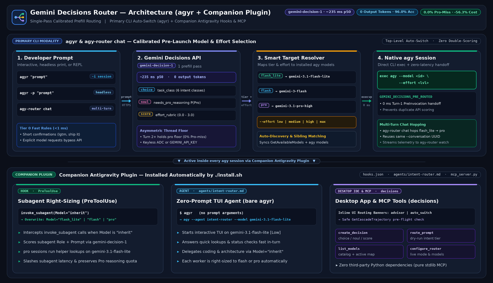
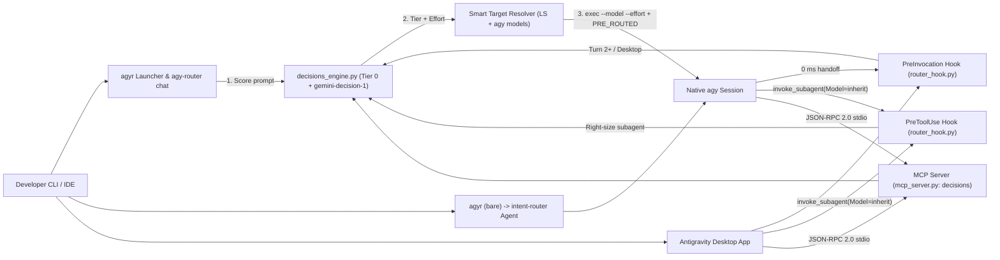
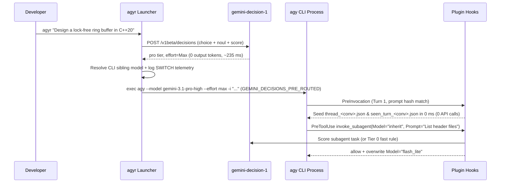

# Architecture Deep Dive: `agyr` & Companion Antigravity Plugin

**Gemini Decisions Router** combines a zero-dependency pre-exec CLI launcher (`agyr`), a multi-turn model-switching REPL (`agy-router chat`), and a companion Antigravity plugin (`hooks.json`, `agents/intent-router.md`, `mcp_server.py`) powered by a shared pure-stdlib Python 3.11+ engine (`decisions_engine.py`).

Instead of autoregressive JSON routing (`480-1,124 ms` to decode `20-145` output tokens), every routing pass evaluates the prompt in **one prefill pass (`~235 ms` `p50`, `0` output tokens)** via `gemini-decision-1`.



## 1. System Topology & Component Responsibilities



| Surface / File | Role in the Stack | When It Runs |
| :--- | :--- | :--- |
| **`agyr`** (`router_hook.py launch` / `run`) | Primary CLI entrypoint. Scores your prompt via `decisions_engine.route_prompt`, resolves an installed CLI `--model` and sibling `--effort` (`low`, `medium`, `high`, `max`), logs `SWITCH` telemetry, sets `GEMINI_DECISIONS_PRE_ROUTED`, and `exec`s `agy`. | Before `agy` starts (`agyr "prompt"`, `agyr -p "prompt"`). |
| **`agy-router chat`** (`router_hook.py chat`) | Interactive multi-turn terminal REPL. Re-scores each turn (`user_turn_count=1..N`) with Asymmetric Thread Floor protection and hops across `flash_lite`, `flash`, and `pro` CLI models while resuming the same `--conversation`. | Every interactive REPL turn (`/new` resets thread; `/exit` quits). |
| **Zero-Prompt TUI** (`agents/intent-router.md`) | Custom Markdown main agent (`mainAgent: true`, `subagent: false`) invoked by bare `agyr` or `agy --agent intent-router`. Answers quick lookups in-turn on `flash_lite` (`--effort low`) and delegates engineering work via `invoke_subagent(TypeName="self", Model="inherit")`. | Bare `agyr` sessions inside the native `agy` TUI. |
| **`PreToolUse` Hook** (`router_hook.py pre-tool-use`) | Intercepts `invoke_subagent` calls when `Model` is unset or `"inherit"` and overwrites `Model` with `flash_lite`, `flash`, or `pro` based on the subagent's `Role` and `Prompt`. | Every `invoke_subagent` tool call across CLI and Desktop App. |
| **`PreInvocation` Hook** (`router_hook.py pre-invocation`) | Seeds Turn 1 state in `0 ms` when `GEMINI_DECISIONS_PRE_ROUTED` is present; otherwise scores user prompts, deduplicates multi-step tool loops, renders `"✦ Routed with Intent"` banners, and manages Desktop App `auto_switch`. | Step 1 of every user turn in Desktop App and standalone `agy`. |
| **MCP Server** (`mcp_server.py`) | Newline-delimited JSON-RPC 2.0 stdio server (`python3 -E -s -B -u`) exposing `create_decision`, `route_prompt`, `list_models`, and `configure_router` under the `decisions` server. | On-demand when called by any Antigravity agent. |
| **Core Engine** (`decisions_engine.py`) | Keyless OAuth2 ADC (`gemini_adc`, `vertex_adc`) and `0600` `.env` `GEMINI_API_KEY` client, input/file security validator, dynamic model discovery cache, and 2-tier router. | Imported by `router_hook.py`, `mcp_server.py`, and benchmarks. |

---

## 2. Two-Tier Calibrated Routing & Asymmetric Thread Floor

### Tier 0: Local Fast Rules (`<1 ms`, `0` Network Calls)

Before making a network request, `_fast_rule_route` resolves deterministic cases locally in under `1 ms`:
- **Explicit User Tier Overrides:** Prompts matching `"use gemini pro"`, `"run claude"`, `"use flash"`, or `"use flash lite"` immediately route to the requested tier (`confidence = 0.99`, `explicit_model_requested = True`).
- **Turn 2+ Short Continuations:** When an active work thread is locked (`locked_task_class != "quick_lookup"`) and the user sends a short continuation (`"yes go ahead"`, `"do step 2 next"`, or `<= 5` non-question words), Tier 0 preserves the active `locked_tier` (`backend = "thread_lock (<1 ms)"`).
- **Operational Confirmations:** Standalone Turn 1 pings (`"lgtm"`, `"ship it"`, `"status"`, `"thanks"`) route to `flash_lite` (`thinking_level = 1`).
- **Crash & Concurrency Markers:** Prompts containing `"race condition"`, `"deadlock"`, `"segfault"`, or `"stack trace"` route directly to `pro` (`thinking_level = 3`).

### Tier 1: Single-Pass `gemini-decision-1` Calibration (`~235 ms` `p50`, `0` Output Tokens)

All other prompts execute a single `CreateDecision` HTTP call (`1.5s` default hook budget; `45s` circuit-breaker fallback to `_lexical_fallback_route` on transient network/quota errors) scoring three orthogonal questions in parallel:

1. **`task_class` (`choice`):** Posterior distribution across `quick_lookup`, `coding_edit`, `writing_docs`, `data_analysis`, and `deep_debug_architecture`.
2. **`needs_pro_reasoning` (`noul`):** Calibrated probability `P(pro)` in `[0.0, 1.0]` measuring whether cross-file architecture, concurrency/security verification, or subtle root-cause synthesis is required.
3. **`effort_rubric` (`score`):** Expected rubric value `effort` in `[0.0, 3.0]` across four levels (`0: Trivial lookup` to `3: Deep architecture / hard bug`).

Tier and thinking effort (`1: Low`, `2: Medium`, `3: High`, `4: Max`) are derived deterministically from the calibrated posteriors:

| Target Tier | Calibration Rule | Thinking Effort (`1..4`) |
| :--- | :--- | :--- |
| **`pro`** | `task_class == "deep_debug_architecture"` OR `P(pro) >= 0.55` OR `effort >= 2.25` | `4` (`Max`) when `P(pro) >= 0.88` and `effort >= 2.75`; else `3` (`High`) |
| **`flash_lite`** | `task_class == "quick_lookup"` AND `P(pro) < 0.25` AND `effort < 1.15` | `1` (`Low`) |
| **`flash`** | All standard coding, refactoring, test, docs, and SQL/data tasks | `2` (`Medium`) when `effort >= 0.90`; else `1` (`Low`) |

Combined route confidence is weighted across all three heads (`0.45 * conf_choice + 0.35 * conf_noul + 0.20 * conf_score`), populating all `4/4` calibration bins (`Brier = 0.0524` across `N=100` live prompts).

### Asymmetric Turn 2+ Thread Floor (`enable_thread_floor`)

Stateless LLM routers frequently drop active `pro` sessions down to `flash_lite` when a developer replies `"sounds good, proceed"`, invalidating KV-cache context and degrading code quality. `_apply_thread_floor` enforces an asymmetric floor via `thread_<conv>.json` (`7d` TTL):
- **Floor Held on Work Threads:** Any `coding_edit`, `writing_docs`, `data_analysis`, or `deep_debug_architecture` turn establishes a floor (`flash` or `pro`). Follow-up continuations never downgrade below `locked_tier` (while upward promotion `flash` -> `pro` is always allowed).
- **Never Locked on Lookups:** `quick_lookup` turns never lock a floor, and standalone high-confidence (`> 0.85`) `quick_lookup` questions on Turn 2+ (containing `?` or starting with an interrogative like `what`, `why`, `how`, `explain`) cleanly unlock back to `flash_lite`.

---

## 3. Zero-Double-Scoring Handoff (`GEMINI_DECISIONS_PRE_ROUTED`)

When `agyr` or `agy-router chat` scores a prompt before launching `agy`, the companion plugin's `PreInvocation` hook will also fire inside the child `agy` process on Turn 1. To guarantee **zero duplicate API calls** and **zero duplicate telemetry rows**, `agyr` passes a compact JSON digest in `GEMINI_DECISIONS_PRE_ROUTED`:



1. `agyr` computes the SHA-256 hash of the normalized prompt, records a single `SWITCH` entry to `~/.cache/gemini-decisions-router/telemetry.jsonl`, prints the `AUTO-SWITCHED` banner to `stderr`, and exports `GEMINI_DECISIONS_PRE_ROUTED`.
2. On Turn 1 inside `agy`, `handle_pre_invocation` verifies that the incoming `lastUserInput` hash matches `GEMINI_DECISIONS_PRE_ROUTED`, writes `thread_<conv>.json`, `active_turn_<conv>.json`, and `seen_turn_<conv>.json` in `<1 ms`, and returns `{}` without calling `route_prompt`.
3. On Turn 2+ of an interactive `agyr "prompt"` TUI session, `lastUserInput` has a new hash, so `PreInvocation` and `PreToolUse` resume normal calibrated routing and subagent right-sizing automatically.

---

## 4. Dynamic Model Auto-Discovery & Sibling Effort Matching

Antigravity Desktop App and `agy` CLI periodically ship new model identifiers and thinking-effort variants. `decisions_engine.py` discovers, classifies, and caches installed models automatically:

1. **Dual-Source Discovery (`discover_installed_models`):**
   - Queries local Antigravity Language Server instances (`GetAvailableModels` HTTP POST over `127.0.0.1` with automatic `/proc` Hub port and `x-codeium-csrf-token` discovery, filtering out tab-autocomplete, image/audio, deprecated, and internal entries).
   - Parses `agy models` CLI output (`parse_agy_models_output`), stripping ANSI spinner control codes and transient log lines.
2. **Private `0600` Discovery Cache:** Saves normalized entries to `~/.cache/gemini-decisions-router/discovered_models.json` (`0700` directory, `0600` file, `O_NOFOLLOW` symlink rejection, `3600s` TTL) so hooks read model catalogs in `<1 ms`.
3. **Automatic Tier, Enum & CLI Sibling Resolution (`resolve_cli_launch_target`):**
   - `infer_model_tier_and_thinking` maps model IDs and labels (`lite` / `-low` -> `flash_lite`, `flash` / `mini` / `haiku` -> `flash`, `pro` / `opus` / `orchestrator` -> `pro`) with default thinking levels `1..4`.
   - `propagate_sibling_model_enums` backfills `MODEL_*` enums across `-low`, `-medium`, `-high`, `-xhigh`, and `-max` siblings for Desktop App `auto_switch`.
   - When `agyr` or `agy-router chat` launches `agy`, `resolve_cli_launch_target` filters out Desktop-only LS models, maps abstract tier targets to installed CLI models, and swaps sibling suffixes to match calibrated thinking effort (`1 -> -low`, `2 -> -medium`, `3 -> -high`, `4 -> -max` / `-xhigh` / `-high`).

Run `agy-router sync-models --apply-recommended` at any time to refresh discovery and persist `suggested_tier_models` into `~/.config/gemini-decisions-router/router_config.json`.

---

## 5. Desktop App `advisor` vs Hardened `auto_switch`

Inside the Antigravity Desktop App (and standalone `agy` sessions launched without `agyr`), `router_hook.py` supports three modes (`agy-router set-mode <advisor|auto_switch|off>`):

- **`advisor` *(Default)*:**
  - Injects `systemMessage.renderInfo` with `"systemMessage": ""` on Desktop App turns so the collapsible `"✦ Routed with Intent"` card renders inline with **`0` prompt token overhead** (and omits string `metadata` fields for protobuf scrubber safety).
  - Deduplicates multi-step tool loops via `seen_turn_<conv>.json` (`600s` TTL): Steps 2..N of the same user turn short-circuit in `<1 ms` and return `{}`.
- **`auto_switch` (with `GetCascadeTrajectory` Anti-Hang Pre-Flight):**
  - Switches the active Desktop App conversation model when `confidence >= min_confidence` (default `0.45`) and the calibrated model differs from `modelName`.
  - **Mandatory Ownership Pre-Flight:** Before returning `{"terminationBehavior": "terminate"}`, `_verify_cascade_ownership` calls `GetCascadeTrajectory` (`400 ms` timeout) against discovered local Language Servers to prove a reachable server owns `conversationId`.
  - **Safe Ephemeral CLI Fallback:** Standalone `agy` CLI uses an ephemeral Language Server where external cascade redispatch is unowned. When `_verify_cascade_ownership` returns `False`, `auto_switch` **never terminates the turn**: it falls back cleanly to `advisor` mode, displays the inline banner, and logs `"auto_switch_fallback": "cascade_unowned"` in `telemetry.jsonl`.
  - **Loop Protection:** Writes `reroute_<conv>.json` (`600s` TTL) before spawning detached `redispatch` (`SendUserCascadeMessage`) so the switched turn displays its `"Auto-Switched"` banner once on Step 2 and short-circuits on Steps 3..N.
- **`off`:** Disables `PreInvocation` and `PreToolUse` hooks while keeping all four MCP tools available on demand.

---

## 6. MCP Tools Reference (`decisions` Server)

`mcp_config.json` launches `python3 -E -s -B -u ${PLUGIN_ROOT}/mcp_server.py`, registering four structured tools under the `decisions` server (`gemini-decisions-router_decisions` namespace):

### 1. `create_decision`

Evaluates `1..32` shared text or allowlisted local file inputs once across `1..64` structured questions (`noul`, `choice`, `score`) with `0` output tokens:

```json
{
  "input": [
    {"text": "Customer requests dropping production table orders_v2 without a snapshot."}
  ],
  "questions": {
    "destructive_change": {
      "type": "noul",
      "instructions": "Could executing this request cause irreversible production data loss?"
    },
    "approval_path": {
      "type": "choice",
      "instructions": "Which approval workflow applies?",
      "criteria": {
        "auto_approve": "Read-only query or reversible sandbox change.",
        "peer_review": "Standard non-destructive staging or production change.",
        "vp_signoff": "Irreversible production data deletion or schema drop."
      }
    },
    "blast_radius": {
      "type": "score",
      "instructions": "Rate operational risk from 0 to 3.",
      "criteria": [
        "0: Read-only operation.",
        "1: Single developer sandbox.",
        "2: Shared staging service.",
        "3: Production data loss or customer outage risk."
      ]
    }
  }
}
```

### 2. `route_prompt`

Classifies any prompt or subagent task description using Tier 0 fast rules + Tier 1 `gemini-decision-1`, returning `recommended_tier` (`flash_lite`, `flash`, `pro`), `recommended_model_id`, `thinking_level` (`1..4`), `confidence`, `rationale`, and calibrated posteriors.

### 3. `list_models`

Returns built-in, dynamically auto-discovered, and custom target models along with `MODEL_*` enums, default thinking levels, `suggested_tier_models`, and `active_tier_models`. Pass `{"refresh": true}` to force live re-discovery from the local Language Server and `agy models`.

### 4. `configure_router`

Persists non-secret router settings to `~/.config/gemini-decisions-router/router_config.json`:

```json
{
  "mode": "advisor",
  "verbosity": "compact",
  "min_confidence": 0.5,
  "enable_subagent_routing": true,
  "enable_thread_floor": true,
  "cli_inline_banner": true,
  "tier_models": {
    "pro": "gemini-3.1-pro-high"
  }
}
```

---

## 7. Security & Hermeticity Invariants

- **Zero Mandatory `pip` Dependencies:** Runtime modules (`decisions_engine.py`, `router_hook.py`, `mcp_server.py`) use only the Python 3.11+ standard library and run isolated via `python3 -E -s -B -u`.
- **Hardened `0600` Credentials & Caches:** `~/.config/gemini-decisions-router/.env` and `~/.cache/gemini-decisions-router/discovered_models.json` live inside `0700` directories with `0600` file permissions and `O_NOFOLLOW` symlink/permission checks (`(st_mode & 0o077) == 0`). Embedded secrets in JSON config files are rejected with `ConfigError`.
- **Path-Traversal & Local File Guards:** Per-conversation state files are sanitized via `safe_state_path` (SHA-256 hashing non-alphanumeric IDs). Local `file` inputs to `create_decision` must reside inside `allowed_dirs` (`<= 4 MiB` per file, `<= 8 MiB` total) and reject symlinks, dotfiles, and credential/key filenames.
- **No Cross-Origin Token Redirects:** Outbound `CreateDecision` HTTPS requests refuse HTTP redirects so `Authorization: Bearer` tokens and `x-goog-api-key` headers never cross origins, and error handlers scrub credentials from logs and tracebacks.

For contributor workflows and test invariants, see [../rules/AGENTS.md](../rules/AGENTS.md) and [TESTING_STRATEGY.md](TESTING_STRATEGY.md).
