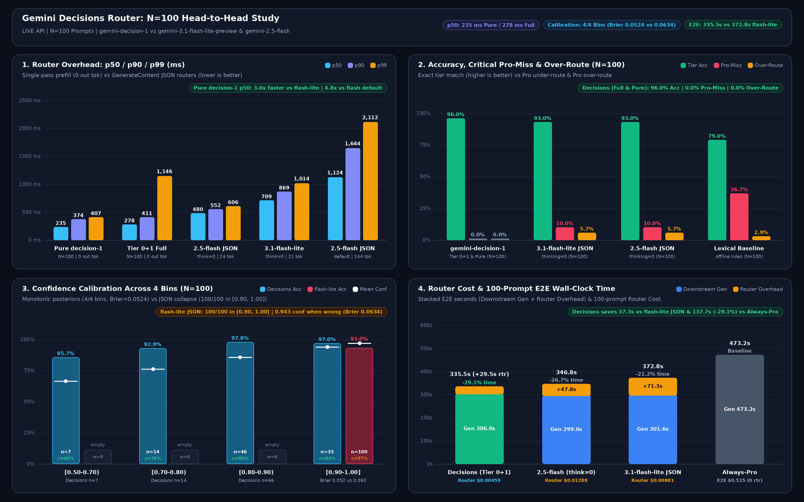

# Gemini Decisions Router: Live Benchmarks


## Executive Summary

We evaluated **Gemini Decisions Router** (`decisions_engine.py`) live against `https://generativelanguage.googleapis.com/v1beta` across **100 stratified developer and agent prompts** (`benchmarks/prompts_100.json`) spanning 6 engineering categories, plus **15 stratified end-to-end (E2E) model completions** across `flash_lite` (`gemini-3.1-flash-lite-preview`), `flash` (`gemini-2.5-flash`), and `pro` (`gemini-2.5-pro`).

| Headline Metric | Gemini Decisions Router (Tier 0+1) | Pure `gemini-decision-1` (Tier 1 Only) | `GenerateContent` JSON Router (`gemini-2.5-flash`) | Offline Lexical Baseline | Always-Pro Baseline |
| :--- | :---: | :---: | :---: | :---: | :---: |
| **Sample Size** | `N=100` | `N=100` | `N=15` (stratified) | `N=100` | `N=100` |
| **Router Latency `p50`** | **`278.2 ms`** *(Tier 0: `<0.1 ms`)* | **`235.3 ms`** | `1,124.3 ms` (**`4.0x` to `4.8x` slower**) | `0.01 ms` | `0.0 ms` |
| **Router Latency `p90` / `p99`** | `411.4 ms` / `1,146.2 ms` | **`374.2 ms` / `407.2 ms`** | `1,643.8 ms` / `2,112.3 ms` | `0.01 ms` / `0.01 ms` | `0.0 ms` |
| **Mean Router Output Tokens** | **`0.0` tokens** | **`0.0` tokens** | `144.3` tokens (`15.3` JSON + `128.9` thought) | `0.0` tokens | `0.0` tokens |
| **Exact 3-Tier Accuracy** | **`96.0%`** (`96/100`) | **`96.0%`** (`96/100`) | `100.0%` (`15/15`) | `79.0%` (`79/100`) | `30.0%` (`30/100`) |
| **5-Way `task_class` Accuracy** | **`93.3%`** (`84/90`) | **`93.3%`** (`84/90`) | `100.0%` (`15/15`) | `44.4%` (`40/90`) | `22.2%` (`20/90`) |
| **Critical Pro-Miss Rate** | **`0.0%`** (`0/30` missed) | **`0.0%`** (`0/30` missed) | `0.0%` (`0/5` missed) | **`36.7%`** (`11/30` missed) | `0.0%` (`0/30`) |
| **Non-Pro Over-Routed to Pro** | **`0.0%`** (`0/70`) | **`0.0%`** (`0/70`) | `0.0%` (`0/10`) | `2.9%` (`2/70`) | **`100.0%`** (`70/70` = `70%` of workload) |
| **100-Prompt Router Cost** | **`$0.0046`** | **`$0.0051`** | `$0.0417` (**`9.1x` higher**) | `$0.0000` | `$0.0000` |
| **100-Prompt Total E2E Time** | **`335.5 s` (`-29.1%`)** | `331.3 s` (`-30.0%`) | `416.0 s` (`-12.1%`) | N/A *(36.7% Pro-miss)* | `473.2 s` *(Baseline)* |
| **100-Prompt Total E2E Cost** | **`$0.225` (`-56.3%`)** | `$0.226` (`-56.2%`) | `$0.258` (`-50.0%`) | N/A | `$0.515` *(Baseline)* |

### Key Takeaways

1. **Single-Pass Prefill Eliminates Router Decoding Overhead:** Traditional `GenerateContent` JSON routing (`gemini-2.5-flash` with `responseMimeType: "application/json"`) required **`1,124.3 ms` at `p50`** (`1,643.8 ms` at `p90`) and generated an average of **`144.3` billed output + thinking tokens** just to emit a 15-token JSON string. By contrast, `gemini-decision-1` evaluates 3 structured questions (`choice`, `noul`, `score`) simultaneously in **one prefill pass with `0` output tokens**, achieving **`235.3 ms` `p50` (`407.2 ms` `p99`)** on warm uncontended calls (`4.8x` faster `p50`) and **`278.2 ms` `p50`** across the combined Tier 0+1 suite (`4.0x` faster `p50`, **`9.1x` lower router API cost**).
2. **`2.4x` More Net Wall-Clock Time Saved Than `GenerateContent` Routing:** On a 100-prompt workload, a traditional `GenerateContent` JSON router adds **`115.2 seconds`** of router latency overhead, consuming **69% of its downstream generation time savings** and leaving only **`12.1%`** net wall-clock speedup. Gemini Decisions Router adds only **`29.5 seconds`** across 100 prompts (with Tier 0 fast rules handling 11% of turns in `<0.1 ms`), delivering a **`29.1%` net wall-clock reduction** (`473.2s -> 335.5s`, saving **`137.7 seconds`** per 100 prompts) and **`56.3%` net API cost savings** even with downstream completions conservatively capped at `maxOutputTokens: 512`.
3. **Zero Frontier Under-Routing (`0.0%` Pro-Miss Rate):** Across all **30** ground-truth `pro` tasks (20 distributed architecture and concurrency debugging prompts, 5 complex causal/queueing data investigations, 3 Turn 2+ asymmetric thread-floor continuations, and 2 explicit overrides), Gemini Decisions Router achieved **`100.0%` Pro recall (`0/30` Pro-misses)** while routing **`0/70`** non-Pro prompts to `pro`. By comparison, the offline keyword heuristic missed **`36.7%` (`11/30`)** of `pro` tasks.

---

## Methodology & Dataset Design

### 1. Stratified 100-Prompt Dataset (`benchmarks/prompts_100.json`)

The benchmark evaluates 100 diverse, non-trivial engineering and agentic prompts across 6 categories:

- **`quick_lookup` (`20` prompts, expected `flash_lite`):** CLI flags (`tar`, `jq`, `git`, `kubectl`, `curl`), HTTP status codes, Python stdlib signatures, SQL syntax checks, port lookups, and regex snippets.
- **`coding_edit` (`20` prompts, expected `flash`):** Single-service engineering implementations including FastAPI validation, `pytest` fixtures, TypeScript state refactors, Go retry middleware, SQLite migrations, streaming CSV parsers, and multi-stage Dockerfiles.
- **`writing_docs` (`15` prompts, expected `flash`):** OpenAPI specs, incident postmortems, onboarding runbooks, ADR templates, release changelogs, PR descriptions, and migration guides.
- **`data_analysis` (`15` prompts, `10` expected `flash` + `5` expected `pro`):** 10 standard SQL cohort/retention/latency/billing queries (`flash`) plus 5 multi-system statistical and queueing root-cause analyses such as Simpson's paradox causal adjustment and GC/connection-pool tail-latency decomposition (`pro`).
- **`deep_debug_architecture` (`20` prompts, expected `pro`):** Multi-region database failover, Raft/Paxos split-brain recovery, lock-free ring buffer ABA memory-ordering bugs, zero-downtime envelope key rotation, OAuth2 token-binding threat models, and distributed saga idempotency under network partitions.
- **`agentic_lifecycle` (`10` prompts, `5` expected `flash_lite` + `5` expected `pro`):** Short operational confirmations (`"ship it"`, `"lgtm"`), Turn 2+ asymmetric thread-floor continuations (`"yes go ahead"` on a `pro`-locked thread), lightweight `PreToolUse` subagent briefs, and explicit model overrides (`"use gemini pro..."`).

Overall ground-truth tier distribution across the 100 prompts: **`25` `flash_lite` (25%)**, **`45` `flash` (45%)**, and **`30` `pro` (30%)**. Static `Always-Pro` therefore over-routes **`70%` of total traffic** (`100%` of the 70 non-Pro prompts).

### 2. Execution Protocol & Fairness Controls

- **Uncontended Sequential Timing (`--concurrency 1`):** All live calls ran sequentially (`concurrency=1`) after a 1-call TLS/auth warmup probe so `p50`, `p90`, `p95`, and `p99` percentiles reflect true single-request client wall-clock latency with zero local thread-pool contention (`0` HTTP retries occurred across the entire 169.8s live run).
- **Stratified End-to-End Sample (`N=15`, `sample_e2e: true`):** 5 `quick_lookup` (`flash_lite`), 5 `coding_edit`/`writing_docs`/`data_analysis` (`flash`), and 5 `deep_debug_architecture` (`pro`) prompts were executed end-to-end through real `generateContent` endpoints (`gemini-3.1-flash-lite-preview`, `gemini-2.5-flash`, and `gemini-2.5-pro`) with `maxOutputTokens: 512` across all tiers. Capping `maxOutputTokens` at `512` is conservative because unconstrained `pro` responses typically emit 1,500 to 4,000 tokens.
- **Standard Public Per-1M Token Pricing (USD):**
  - `gemini-decision-1`: `$0.10` input / `$0.00` output (`0` output tokens)
  - `flash_lite`: `$0.10` input / `$0.40` output
  - `flash` (and `llm_json_router` on `gemini-2.5-flash`): `$0.30` input / `$2.50` output (including billed `thoughtsTokenCount`)
  - `pro`: `$1.25` input / `$10.00` output (including billed `thoughtsTokenCount`)

---

## Reproducibility & Live Streaming Commands

Both `benchmarks/run_benchmark.py` and `benchmarks/run_router_head_to_head.py` stream real-time `[001/100] .. [100/100]` routing progress lines (`flush=True`) followed by a `ROUTED WITH INTENT | BENCHMARK ROUTING STATS` summary box directly to `stdout`. Pass `--quiet` whenever you want to suppress per-prompt lines and print only the final summary box (for example in CI logs).

```bash
# 1. Run deterministic offline mock benchmark (<0.1s, zero network calls, streams live stdout stats)
python3 benchmarks/run_benchmark.py --mock --output /tmp/mock_bench.json

# 2. Run deterministic offline N=100 flash-lite & flash JSON head-to-head (live per-prompt stdout stream)
python3 benchmarks/run_router_head_to_head.py --mock --output /tmp/mock_h2h.json

# 3. Summary-only mode (--quiet suppresses [001/100]..[100/100] lines while keeping the stats box)
python3 benchmarks/run_router_head_to_head.py --mock --quiet --output /tmp/mock_h2h.json

# 4. Run full live 100-prompt + 15-prompt E2E benchmark (uses ~/.config/gemini-decisions-router/.env or ADC)
python3 benchmarks/run_benchmark.py \
  --dataset benchmarks/prompts_100.json \
  --output benchmarks/results_100.json \
  --concurrency 1

# 5. Run full live N=100 flash-lite & flash JSON router head-to-head benchmark (streams live routing stats)
python3 benchmarks/run_router_head_to_head.py \
  --dataset benchmarks/prompts_100.json \
  --output benchmarks/results_flash_lite_router_100.json \
  --concurrency 1

# 6. Recompute & print the live head-to-head summary box from saved records without network calls
python3 benchmarks/run_router_head_to_head.py --recompute-only --quiet

# 7. Render both dark-theme benchmark PNG charts (1600x1040 dashboard + 1600x1000 head-to-head)
python3 benchmarks/render_charts.py \
  --input benchmarks/results_100.json \
  --output assets/benchmark-dashboard.png

python3 benchmarks/render_head_to_head_chart.py \
  --input benchmarks/results_flash_lite_router_100.json \
  --baseline benchmarks/results_100.json \
  --output assets/router-head-to-head.png
```

---

## Detailed Benchmark Results

### 1. Router Latency & Token Overhead

| Router Strategy | Calls (`N`) | Tier 0 Hits (`<1 ms`) | `min` (ms) | `p50` (ms) | `p90` (ms) | `p95` (ms) | `p99` (ms) | `max` (ms) | `mean` (ms) | Mean In / Out Tokens | Cost / 100 Prompts |
| :--- | :---: | :---: | :---: | :---: | :---: | :---: | :---: | :---: | :---: | :---: | :---: |
| **`decisions_router_full` (Tier 0+1)** | `100` | `11` | `0.01` | **`278.2`** | **`411.4`** | `520.3` | `1,146.2` | `1,717.0` | `295.0` | `459.1` / **`0.0`** | **`$0.0046`** |
| **`decisions_tier1_only` (Pure `gemini-decision-1`)** | `100` | `0` | `131.7` | **`235.3`** | **`374.2`** | **`401.2`** | **`407.2`** | **`413.4`** | **`252.5`** | `513.1` / **`0.0`** | **`$0.0051`** |
| **`llm_json_router` (`gemini-2.5-flash` JSON)** | `15` | `0` | `511.4` | `1,124.3` | `1,643.8` | `1,901.5` | `2,112.3` | `2,165.0` | `1,151.6` | `186.9` / `144.3` | `$0.0417` |
| **`lexical_only` (Offline Fallback)** | `100` | `100` | `0.00` | `0.01` | `0.01` | `0.01` | `0.01` | `0.02` | `0.01` | `0.0` / `0.0` | `$0.0000` |

> [!NOTE]
> On the identical `N=15` single-turn sample (`sample_15_apples_to_apples`), pure `gemini-decision-1` achieved **`216.2 ms` `p50`** and Tier 0+1 achieved **`303.7 ms` `p50`** versus **`1,124.3 ms` `p50`** for `GenerateContent` JSON routing (`3.7x` to `5.2x` faster `p50`). Note also why `GenerateContent` JSON routing averaged `1,151.6 ms`: even with `temperature: 0.0` and `responseMimeType: "application/json"`, `gemini-2.5-flash` expended an average of `128.9` internal reasoning tokens before emitting `15.3` JSON tokens (`144.3` total billed output tokens per routing decision).

---

### 2. Per-Category Accuracy & Pro-Miss Analysis (`N=100`)

| Category | Prompts | Expected Tier(s) | Tier 0+1 Tier Acc | Pure Tier 1 Tier Acc | Lexical Tier Acc | Tier 0+1 `task_class` Acc | Tier 0+1 Pro-Misses | Lexical Pro-Misses |
| :--- | :---: | :---: | :---: | :---: | :---: | :---: | :---: | :---: |
| **`quick_lookup`** | `20` | `20` `flash_lite` | **`80.0%`** (`16/20`) | **`80.0%`** (`16/20`) | `65.0%` (`13/20`) | `95.0%` | `0 / 0` | `0 / 0` |
| **`coding_edit`** | `20` | `20` `flash` | **`100.0%`** (`20/20`) | **`100.0%`** (`20/20`) | `100.0%` (`20/20`) | `100.0%` | `0 / 0` | `0 / 0` |
| **`writing_docs`** | `15` | `15` `flash` | **`100.0%`** (`15/15`) | **`100.0%`** (`15/15`) | `86.7%` (`13/15`) | `100.0%` | `0 / 0` | `0 / 0` |
| **`data_analysis`** | `15` | `10` `flash`, `5` `pro` | **`100.0%`** (`15/15`) | **`100.0%`** (`15/15`) | `93.3%` (`14/15`) | `66.7%` | **`0 / 5`** | `1 / 5` |
| **`deep_debug_architecture`** | `20` | `20` `pro` | **`100.0%`** (`20/20`) | **`100.0%`** (`20/20`) | `60.0%` (`12/20`) | `100.0%` | **`0 / 20`** | **`8 / 20`** |
| **`agentic_lifecycle`** | `10` | `5` `flash_lite`, `5` `pro` | **`100.0%`** (`10/10`) | **`100.0%`** (`10/10`) | `70.0%` (`7/10`) | `100.0%` | **`0 / 5`** | `2 / 5` |
| **Total / Overall** | **`100`** | `25` / `45` / `30` | **`96.0%`** (`96/100`) | **`96.0%`** (`96/100`) | **`79.0%`** (`79/100`) | **`94.0%`** (`93.3%` 5-way) | **`0 / 30` (`0.0%`)** | **`11 / 30` (`36.7%`)** |

#### 3x3 Tier Confusion Matrix (`decisions_router_full`, `N=100`)

| Ground Truth \ Routed Tier | Routed `flash_lite` | Routed `flash` | Routed `pro` | Row Recall |
| :--- | :---: | :---: | :---: | :---: |
| **Expected `flash_lite` (`25`)** | **`21`** | `4` | `0` | `84.0%` (`0` under-routed, `0` sent to `pro`) |
| **Expected `flash` (`45`)** | `0` | **`45`** | `0` | **`100.0%`** |
| **Expected `pro` (`30`)** | `0` | `0` | **`30`** | **`100.0%`** (`0.0%` Pro-Miss Rate) |

**Error & Boundary Analysis:**
- **Zero Under-Routing (`0/100`):** Neither `decisions_router_full` nor `decisions_tier1_only` ever routed a `pro` prompt to `flash`/`flash_lite` or a `flash` prompt to `flash_lite`.
- **Conservative Borderline Escalation (`4/100`):** All 4 routing differences across the 100-prompt suite occurred on multi-clause `quick_lookup` questions (regex lookarounds or multi-flag CLI commands) where `effort_rubric` scored slightly above `0.85`, nudging the route one step up from `flash_lite` to `flash` rather than risking a truncated answer.
- **Multi-Signal Fusion (`data_analysis`):** On the 5 complex causal/queueing `data_analysis` prompts, `gemini-decision-1` classified `task_class` as `deep_debug_architecture` or set `P(needs_pro_reasoning) >= 0.55` and `effort_rubric >= 2.25`, achieving **`100.0%` (`15/15`)** exact tier separation between the 10 `flash` SQL tasks and the 5 `pro` root-cause investigations.

---

### 3. Confidence Calibration (`decisions_tier1_only`, `N=100`)

`gemini-decision-1` returns native per-question confidence scores without sampling multiple completions. Combining confidence across `task_class` (`0.45`), `needs_pro_reasoning` (`0.35`), and `effort_rubric` (`0.20`) yields well-ordered uncertainty estimates (`ECE = 0.1179` on pure Tier 1, **`ECE = 0.1031`** on Tier 0+1):

| Confidence Bin | Prompt Count (`Pure Tier 1`) | Mean Predicted Confidence | Empirical Tier Accuracy | Calibration Gap (`|Acc - Conf|`) |
| :--- | :---: | :---: | :---: | :---: |
| **`0.00 - 0.70`** | `9` | `64.1%` | `88.9%` | `0.2476` *(under-confident, safe)* |
| **`0.70 - 0.80`** | `17` | `75.9%` | `94.1%` | `0.1820` *(under-confident, safe)* |
| **`0.80 - 0.90`** | `48` | `85.6%` | `97.9%` | `0.1232` |
| **`0.90 - 1.00`** | `26` | `94.0%` | **`96.2%`** | **`0.0212`** |

Notice the directional safety property: across every bin, empirical accuracy **exceeds** predicted confidence (mildly conservative under-confidence rather than dangerous over-confidence), and the top confidence bin (`>= 0.90`) exhibits a calibration gap of just **`2.1%`**. This makes `min_confidence` thresholds (`0.45` default, `0.55` recommended for strict `auto_switch`) reliable in production.

---

### 4. End-to-End Wall-Clock Time & API Cost Savings

#### Downstream Tier Completion Baselines (`maxOutputTokens: 512`)

| Target Tier | Probed Live Model | Mean Completion Latency | `p50` Completion Latency | Mean Prompt / Output Tokens | Mean Completion Cost |
| :--- | :--- | :---: | :---: | :---: | :---: |
| **`flash_lite`** | `gemini-3.1-flash-lite-preview` | **`1,435.0 ms`** (`3.3x` faster) | `1,399.2 ms` | `20.2` / `352.2` | **`$0.000143`** (`36x` cheaper) |
| **`flash`** | `gemini-2.5-flash` | **`2,726.9 ms`** (`1.7x` faster) | `2,747.4 ms` | `48.7` / `508.0` | **`$0.001285`** (`4.0x` cheaper) |
| **`pro`** | `gemini-2.5-pro` | `4,742.6 ms` (`1.0x`) | `4,673.2 ms` | `48.9` / `509.0` | `$0.005151` (`1.0x`) |

#### Empirical 15-Prompt Sample & Projected 100-Prompt Workload

| Workload & Strategy | Router Overhead (s) | Generation Time (s) | Total E2E Wall Time (s) | Net Time Saved vs Always-Pro | Router Cost (USD) | Generation Cost (USD) | Total E2E Cost (USD) | Net Cost Saved vs Always-Pro |
| :--- | :---: | :---: | :---: | :---: | :---: | :---: | :---: | :---: |
| **15-Prompt Live Sample: Always-Pro** | `0.00 s` | `71.14 s` | `71.14 s` | `0.0%` | `$0.0000` | `$0.0773` | `$0.0773` | `0.0%` |
| **15-Prompt Live Sample: `GenerateContent`-Routed** | `17.27 s` | `46.22 s` | `63.50 s` | `-10.7%` | `$0.0063` | `$0.0330` | `$0.0393` | `-49.1%` |
| **15-Prompt Live Sample: Gemini Decisions Router** | **`4.57 s`** | `46.95 s` | **`51.52 s`** | **`-27.6%`** | **`$0.0008`** | `$0.0341` | **`$0.0349`** | **`-54.8%`** |
| **100-Prompt Workload: Always-Pro** | `0.00 s` | `473.21 s` | `473.21 s` | `0.0%` | `$0.0000` | `$0.5154` | `$0.5154` | `0.0%` |
| **100-Prompt Workload: `GenerateContent`-Routed** | `115.16 s` | `300.86 s` | `416.02 s` | `-12.1%` | `$0.0417` | `$0.2159` | `$0.2576` | `-50.0%` |
| **100-Prompt Workload: Gemini Decisions Router** | **`29.50 s`** | `306.03 s` | **`335.53 s`** | **`-29.1%`** | **`$0.0046`** | `$0.2205` | **`$0.2251`** | **`-56.3%`** |

---

### 5. `N=100` Head-to-Head Study: `gemini-decision-1` vs `flash-lite` & `flash` JSON Routers



A common engineering question is: *"What if we disable thinking (`thinkingBudget: 0`), enforce `responseMimeType: "application/json"`, and use `gemini-3.1-flash-lite-preview` or `gemini-2.5-flash` as a lightweight structured-output router across all 100 prompts?"*

We executed that exact 100-prompt head-to-head live in `benchmarks/run_router_head_to_head.py` (`benchmarks/results_flash_lite_router_100.json`, sequential `concurrency=1`, `0` HTTP retries, `0` JSON parse errors):

| Head-to-Head Metric (`N=100`) | Gemini Decisions Router (Tier 0+1) | Pure `gemini-decision-1` (Tier 1) | `flash-lite` JSON Router (`gemini-3.1-flash-lite-preview`, `thinkingBudget=0`) | `flash` JSON Router (`gemini-2.5-flash`, `thinkingBudget=0`) | `flash` JSON Router (`gemini-2.5-flash`, default thinking, `N=15`) |
| :--- | :---: | :---: | :---: | :---: | :---: |
| **Router Latency `p50`** | **`278.2 ms`** | **`235.3 ms`** | `709.4 ms` (**`2.55x-3.01x` slower**) | `480.0 ms` (`1.73x-2.04x` slower) | `1,124.3 ms` (`4.04x-4.78x` slower) |
| **Router Latency `p90` / `p99`** | `411.4 ms` / `1,146.2 ms` | **`374.2 ms` / `407.2 ms`** | `868.9 ms` / `1,014.2 ms` | `552.1 ms` / `606.2 ms` | `1,643.8 ms` / `2,112.3 ms` |
| **100-Prompt Router Overhead** | **`29.50 s`** | **`25.25 s`** | `71.26 s` (`+41.8s` vs Decisions) | `47.81 s` (`+18.3s` vs Decisions) | `115.16 s` (`+85.7s` vs Decisions) |
| **Mean In / Out Tokens** | `459.1` / **`0.0`** | `513.1` / **`0.0`** | `228.1` / `20.7` (`0` thought) | `228.1` / `24.1` (`0` thought) | `186.9` / `144.3` (`128.9` thought) |
| **Exact 3-Tier Accuracy** | **`96.0%`** (`96/100`) | **`96.0%`** (`96/100`) | `93.0%` (`93/100`) | `93.0%` (`93/100`) | `100.0%` (`15/15` single-turn) |
| **5-Way `task_class` Accuracy** | **`93.3%`** (`84/90`) | **`93.3%`** (`84/90`) | `93.3%` (`84/90`) | `95.6%` (`86/90`) | `100.0%` (`15/15` single-turn) |
| **Critical Pro-Miss Rate** | **`0.0%`** (`0/30`) | **`0.0%`** (`0/30`) | **`10.0%`** (`3/30` missed) | **`10.0%`** (`3/30` missed) | `0.0%` (`0/5` single-turn) |
| **Non-Pro Over-Routed to Pro** | **`0.0%`** (`0/70`) | **`0.0%`** (`0/70`) | `5.7%` (`4/70`) | `5.7%` (`4/70`) | `0.0%` (`0/10`) |
| **Confidence Bins Populated (`4` bins)** | **`4 / 4`** (`0.66 -> 0.94`) | **`4 / 4`** (`0.64 -> 0.94`) | **`1 / 4`** (`100/100` in `[0.90, 1.00]`) | **`1 / 4`** (`100/100` in `[0.90, 1.00]`) | `0 / 4` (no probabilities) |
| **Mean Confidence When Wrong** | **`0.814`** (`Brier = 0.0524`) | **`0.814`** (`Brier = 0.0583`) | **`0.943`** (`7/7` errors `>= 0.85`, `Brier = 0.0634`) | **`0.900`** (`7/7` errors `>= 0.85`, `Brier = 0.0633`) | N/A |
| **Router Cost / 100 Prompts** | **`$0.00459`** | **`$0.00513`** | `$0.00881` (`$0.25/$1.50` preview rates; `$0.00311` at `$0.10/$0.40`) | `$0.01288` (`2.80x` higher) | `$0.04168` (`9.08x` higher) |
| **Projected 100-Prompt E2E Time** | **`335.53 s` (`-29.1%`)** | **`331.27 s` (`-30.0%`)** | `372.84 s` (`-21.2%`, `+37.3 s` slower) | `346.81 s` (`-26.7%`) | `416.02 s` (`-12.1%`) |

#### Calibration Pathology: Why Verbalized JSON Confidence Collapses (`100/100` in `[0.90, 1.00]`)

A critical difference between `gemini-decision-1` and `GenerateContent` JSON routers appears when inspecting **confidence calibration across bins**:

| Confidence Bin | `gemini-decision-1` (Tier 0+1) Count | `gemini-decision-1` Mean Conf / Empirical Acc | `flash-lite` JSON (`thinking=0`) Count | `flash-lite` JSON Mean Conf / Empirical Acc | `flash` JSON (`thinking=0`) Count | `flash` JSON Mean Conf / Empirical Acc |
| :--- | :---: | :---: | :---: | :---: | :---: | :---: |
| **`[0.50, 0.70)`** *(0.00-0.70)* | **`7`** | `66.4%` conf / **`85.7%`** acc | `0` *(empty)* | N/A | `0` *(empty)* | N/A |
| **`[0.70, 0.80)`** | **`14`** | `76.1%` conf / **`92.9%`** acc | `0` *(empty)* | N/A | `0` *(empty)* | N/A |
| **`[0.80, 0.90)`** | **`46`** | `85.7%` conf / **`97.8%`** acc | `0` *(empty)* | N/A | `0` *(empty)* | N/A |
| **`[0.90, 1.00]`** | **`33`** | `93.9%` conf / **`97.0%`** acc | **`100`** *(collapsed)* | `97.0%` conf / **`93.0%`** acc | **`100`** *(collapsed)* | `92.1%` conf / **`93.0%`** acc |
| **Overall Calibration Summary** | **`4 / 4` bins** (`stdev = 0.083`) | **`Brier = 0.0524`**, wrong conf = `0.814` | **`1 / 4` bins** (`stdev = 0.023`) | **`Brier = 0.0634`**, wrong conf = **`0.943`** | **`1 / 4` bins** (`stdev = 0.031`) | **`Brier = 0.0633`**, wrong conf = **`0.900`** |

**Three Structural Takeaways from the `N=100` Head-to-Head:**
1. **`2.55x` to `3.01x` Faster `p50` Latency & `37.3s` Faster E2E:** Even with `thinkingBudget: 0`, `maxOutputTokens: 96`, and `temperature: 0.0`, `gemini-3.1-flash-lite-preview` still had to autoregressively decode `20.7` JSON tokens per call (`709.4 ms` `p50`, `868.9 ms` `p90`, `1,014.2 ms` `p99`), adding **`71.26 seconds`** of pure router overhead per 100 prompts versus **`25.25s` to `29.50s`** for `gemini-decision-1` (`37.31 seconds` saved per 100 prompts end-to-end).
2. **Zero Frontier Drops vs `10.0%` Stateless Pro-Misses & `5.7%` Over-Routes:** Both `flash-lite` and `flash` JSON routers dropped all 3 Turn 2+ `pro`-locked continuation prompts (`"yes go ahead"`, `"do step 2 next"`, `"sounds good, proceed"`) down to `flash_lite`/`flash` (`10.0%` Critical Pro-Miss Rate, breaking KV-cache continuity mid-session) while simultaneously over-routing `4/70` `flash` coding/docs/SQL tasks up to `pro` (`5.7%` over-route rate vs `0.0%` for `gemini-decision-1`).
3. **Verbalized Overconfidence Defeats `min_confidence` Gating:** Asking an autoregressive LLM to emit a `"confidence": 0.95` float inside JSON triggers severe verbalized overconfidence ([Xiong et al., ICLR 2024, arXiv:2306.13063](https://arxiv.org/abs/2306.13063)). Both `gemini-3.1-flash-lite-preview` and `gemini-2.5-flash` collapsed **100 out of 100 prompts into `[0.90, 1.00]`** (`stdev = 0.023` and `0.031`), reporting **`0.943` and `0.900` mean confidence on their 7 misrouted prompts** (`7/7` errors had `confidence >= 0.85`). Any `min_confidence` gate in `[0.45, 0.90]` becomes a no-op on verbalized JSON scores, whereas `gemini-decision-1` derives calibrated posteriors from a single prefill pass across all `4/4` bins (`Brier = 0.0524`).

---

## 6. Competitive LLM Routing Frameworks Comparison

### Architectural Taxonomy

Modern LLM routing systems fall into five established architectural families, to which **Gemini Decisions Router (`gemini-decision-1`)** adds a distinct sixth paradigm:

1. **Trained Preference Classifiers - RouteLLM (LMSYS / UC Berkeley):** Supervised and similarity-weighted pairwise routers (`mf`, `sw_ranking`, `bert`, `causal_llm`) trained on ~80k Chatbot Arena preference battles to predict `P(strong_wins)` between a fixed strong/weak model pair ([Ong et al., ICLR 2025, arXiv:2406.18665](https://arxiv.org/abs/2406.18665); [GitHub: `lm-sys/RouteLLM`](https://github.com/lm-sys/RouteLLM)).
2. **Static Utterance Embedding Routers - Semantic Router (Aurelio AI):** Dense or sparse vector encoders (`FastEmbed`, OpenAI, Cohere) paired with cosine-similarity lookup against pre-written example utterances and per-route `score_threshold` cutoffs ([GitHub: `aurelio-labs/semantic-router`](https://github.com/aurelio-labs/semantic-router)).
3. **Local Small-LM & Envoy Proxy Routers - Katanemo Arch-Router-1.5B / ArchGW (Plano) & vLLM Semantic Router:** Self-hosted Envoy proxy data planes powered either by a fine-tuned `1.5B` generative LM emitting JSON route names ([Tran et al., 2025, arXiv:2506.16655](https://arxiv.org/abs/2506.16655); [HuggingFace: `katanemo/Arch-Router-1.5B`](https://huggingface.co/katanemo/Arch-Router-1.5B)) or fine-tuned `ModernBERT` classifiers inside an Envoy `ext_proc` Rust/Go filter ([When to Reason: Semantic Router for vLLM, arXiv:2510.08731](https://arxiv.org/abs/2510.08731); [GitHub: `vllm-project/semantic-router`](https://github.com/vllm-project/semantic-router)).
4. **Orchestration Structured-Output Routers - LangGraph / LlamaIndex / PydanticAI (`GenerateContent` JSON Classifier):** Application-level conditional edges (`with_structured_output` in [LangGraph](https://langchain-ai.github.io/langgraph/), `LLMSingleSelector` / `PydanticSingleSelector` in [LlamaIndex](https://docs.llamaindex.ai/), typed `output_type` in [PydanticAI](https://ai.pydantic.dev/)) calling a lightweight generative model (`gemini-3.1-flash-lite-preview`, `gemini-2.5-flash`, or `gpt-4o-mini`) with `responseMimeType: "application/json"`.
5. **Commercial Hosted Meta-Routers & Gateways - NotDiamond, Martian, OpenRouter (`openrouter/auto`):** Hosted SaaS routing APIs ([NotDiamond](https://www.notdiamond.ai/)) and multi-provider proxy gateways ([Martian Model Mapping](https://withmartian.com/), [OpenRouter Auto Router](https://openrouter.ai/docs/features/auto-router)) that select downstream endpoints via proprietary meta-classifiers or rolling market telemetry.
6. **Single-Pass Prefill Rubric Scoring + Stateful Agentic Hooks - Gemini Decisions Router (`gemini-decision-1`):** Evaluates multiple zero-shot structured questions (`choice`, `noul`, `score`) simultaneously in **one forward prefill pass with `0` output tokens**, fused with `<0.1 ms` Tier 0 fast rules, smart Turn 2+ KV-cache thread floors, `PreToolUse` `invoke_subagent` right-sizing, and dynamic `agy models` / Language Server catalog discovery.

### Side-by-Side Engineering Comparison Matrix

| Engineering Dimension | Gemini Decisions Router (`gemini-decision-1`, Tier 0+1) | RouteLLM (`mf`, `sw_ranking`, `bert`, `causal_llm`) | Semantic Router (Aurelio AI) | Arch-Router-1.5B (ArchGW) & vLLM Semantic Router | LangGraph / LlamaIndex / PydanticAI (`flash-lite` / `flash` JSON) | Commercial Hosted Routers (NotDiamond, Martian, `openrouter/auto`) |
| :--- | :--- | :--- | :--- | :--- | :--- | :--- |
| **Core Mechanism** | **Tier 0** local rules (`<0.1 ms`) + **Tier 1** 1-pass prefill over 3 rubric questions (`choice` + `noul` + `score`) | Pairwise `P(strong_wins)` via Matrix Factorization (`mf`), Elo (`sw_ranking`), `BERT`, or `Llama-3-8B` ([arXiv:2406.18665](https://arxiv.org/abs/2406.18665)) | Dense/sparse encoder + cosine similarity over static example `utterances` | **Arch-Router:** `Qwen2.5-1.5B` JSON decode ([arXiv:2506.16655](https://arxiv.org/abs/2506.16655)). **vLLM SR:** Rust/Candle `ModernBERT` Envoy filter ([arXiv:2510.08731](https://arxiv.org/abs/2510.08731)) | Autoregressive `GenerateContent` constrained to Pydantic / JSON schema (`responseMimeType: "application/json"`) | **NotDiamond:** SaaS ML meta-classifier. **Martian:** Model Mapping gateway. **OpenRouter:** ~30-task market router |
| **Router Output Tokens** | **`0` output tokens** (`0` thought tokens) | `0` (`mf`, `sw_ranking`, `bert`); `1` token (`causal_llm`) | **`0` output tokens** (vector embedding only) | **Arch-Router:** `~8-15` JSON tokens. **vLLM SR:** `0` tokens | **`20.7` (`flash-lite`, `thinking=0`) to `144.3` (`flash` default)** | `0` client-visible tokens (opaque server-side classification) |
| **Routing Latency (`p50` / `p99`)** | **`235 ms` Pure / `278 ms` Full `p50`; `407 ms` / `1,146 ms` `p99`** (Tier 0 `<0.1 ms`) | `~6.4-23.6 ms` on dedicated L4 GPU + `~50-150 ms` OpenAI embed RTT (`~345 ms` CPU on `sw_ranking`) | `~5-15 ms` (local ONNX `FastEmbed`) or `~45-120 ms` (cloud embedding API) | **Arch-Router:** `~51 ms` GPU (`~250-600 ms` CPU). **vLLM SR:** `~5-20 ms` local Envoy filter | **`480-709 ms` `p50` / `606-1,014 ms` `p99`** (`thinking=0`); **`1,124 ms` `p50` / `2,112 ms` `p99`** (default thinking) | **NotDiamond:** `~100-150 ms` SDK RTT. **Martian / OpenRouter:** `~20-80 ms` in-gateway |
| **Zero-Shot Rubric Flexibility** | **High (Zero-Shot):** `1-64` arbitrary `noul`, `choice` (`<=255` options), and `score` questions in 1 call; zero retraining | **Low:** Binary strong/weak split trained on ~80k Arena pairs; new tiers or criteria require preference data & re-fitting | **Low-Medium:** Requires curating `10-50+` utterances per route; conflates topic similarity with reasoning depth | **Arch-Router:** Medium-High (domain/action JSON policies, no numeric `score`/`noul` fusion). **vLLM SR:** Low (requires `ModernBERT` fine-tuning) | **High (Zero-Shot):** Arbitrary JSON schema in system prompt, but latency grows linearly with schema fields and output tokens | **Low:** Fixed `cost`/`quality`/`latency` sliders; NotDiamond custom routers require labeled evaluation datasets |
| **Calibration & Confidence Gating** | **Calibrated Prefill Posteriors:** `4/4` bins populated, `ECE = 0.1031`, `Brier = 0.0524`, conservative under-confidence | Scalar pairwise win score (`P(strong_wins)`); uncalibrated across multi-dimensional rubrics | Uncalibrated cosine similarity (`[-1, 1]`); requires `RouteLayer.fit()` threshold sweeps | **Arch-Router:** Uncalibrated greedy JSON text. **vLLM SR:** Raw `ModernBERT` softmax logits | **Verbalized Overconfidence:** `100/100` collapsed in `[0.90, 1.00]`, `0.900-0.943` mean conf when wrong ([arXiv:2306.13063](https://arxiv.org/abs/2306.13063)) | **Opaque:** Returns winning model string (`openrouter/auto`, Martian) or proprietary score without rubric posteriors |
| **Agentic Lifecycle Awareness** | **Native Full-Lifecycle:** Smart Turn 2+ thread floor, `PreToolUse` `invoke_subagent` right-sizing, `agy models` + LS auto-discovery, cascade ownership check | **None (Stateless):** Downgrades Turn 2+ `"yes go ahead"` continuations, busting KV caches and losing Pro context | **None (Stateless):** No turn-floor lock, subagent tool-hook interception, or model catalog discovery | **Partial (Gateway-Only):** Inspects multi-turn HTTP payloads in Envoy, but lacks IDE `PreToolUse` subagent hooks or local CLI discovery | **Manual DIY:** Developers must hand-code thread state, KV-cache floor logic, subagent interceptors, and JSON parse fallbacks (`10%` stateless Pro-miss) | **Gateway Stickiness Only:** Basic provider stickiness/failover, no client hook or `invoke_subagent` awareness |
| **Client & Infra Footprint** | **Zero-Dependency Client:** Pure Python 3.11+ stdlib (`0` pip pkgs, `0` local GPUs/VRAM); keyless ADC or `0600` `.env` | **Heavy Python + GPU/API:** PyTorch/Transformers + `~16 GB` VRAM (`causal_llm`) or L4 GPU + OpenAI embedding key | **Python SDK + Encoder:** `semantic-router` package + `100-500 MB` local ONNX model or external embedding key | **Heavy Infra / Proxy:** Envoy proxy + Docker/K8s + dedicated GPU (`~3-4 GB` VRAM) or Rust/Candle + Go FFI daemon | **Framework SDK:** LangChain/LangGraph, LlamaIndex, or PydanticAI dependency tree + cloud LLM credentials | **External SaaS / Proxy:** Third-party SDK (`notdiamond`) or routing all prompt traffic through an external multi-tenant gateway |
| **Offline / Failure Resilience** | **3-Layer Fail-Open:** `1.5s` hook deadline + `45s` circuit-breaker (`api_cooldown.json`) + `<0.1 ms` lexical fallback + Turn 2+ floor preserved | Local `bert`/`causal_llm` work offline if GPU healthy; `mf`/`sw_ranking` fail if external embedding API times out | **High (Local ONNX):** Works offline with local `FastEmbed`; fails open to `None` default route below threshold | Runs inside private cluster, but Envoy `ext_proc` or GPU pod outage requires proxy bypass rules | Fragile unless wrapped in custom retry/schema/timeout fallback guards around `GenerateContent` | Cloud-only; fails completely offline and requires external third-party prompt egress |
| **Cost per `1,000` Routes (USD)** | **`~$0.046` / 1k routes** (`459.1` mean in tok @ `$0.10/1M` in, `$0.00` out; `$0` idle infra) | `~$0.003-$0.039` / 1k at 100% GPU saturation, **plus `$500-$800/mo` idle L4 GPU cost** at interactive dev QPS + `~$0.01/1k` embeddings | `$0.00` API (local CPU ONNX) or `~$0.01` / 1k (OpenAI `text-embedding-3-small`) | `$0.00` per-token API, but requires **`$150-$800/mo`** dedicated GPU/CPU proxy cluster footprint | **`~$0.031-$0.088` / 1k** (`flash-lite` JSON) up to **`~$0.129-$0.417` / 1k** (`gemini-2.5-flash` JSON) | **NotDiamond:** `~$0.025-$1.00 / 1k` (`$0.05/1M` routed tokens). **Martian:** `$19+/mo`. **OpenRouter:** `$0` router fee (`~5.5%` credit fee) |

### Architectural Analysis Across the Six Engineering Dimensions

1. **Single-Pass Prefill vs Autoregressive Decoding & Pooled Embeddings:**
   - `gemini-decision-1` executes a **single transformer prefill pass** over the prompt and rubric criteria (`task_class`, `needs_pro_reasoning`, `effort_rubric`) and extracts normalized posterior distributions directly without entering an autoregressive token-generation loop (`0` candidate tokens, `0` thought tokens across all 100 prompts).
   - Autoregressive JSON routers (`LangGraph` / `LlamaIndex` / `PydanticAI` and `Arch-Router-1.5B`) must sequentially sample JSON tokens (`{`, `"`, `t`, `i`, `e`, `r`, ...), incurring `480-709 ms` `p50` even with `thinkingBudget: 0` (`1,124 ms` `p50` with default thinking on `gemini-2.5-flash`).
   - Pooled dense embeddings (`Aurelio Semantic Router`, `RouteLLM mf`) emit `0` output tokens, keeping inference fast, but compress prompts into topical vectors that conflate **domain topic** with **reasoning depth**: *"Write a SQL query counting daily signups"* (`flash`) and *"Prove whether our SQL cohort attribution suffers from Simpson's paradox under delayed backfills"* (`pro`) share SQL vocabulary while requiring completely different reasoning tiers.
2. **Zero-Shot Multi-Signal Fusion vs Supervised Retraining Loops:**
   - `decisions_engine.py` fuses `choice` (`task_class`), `noul` (`needs_pro_reasoning`), and `score` (`effort_rubric` in `[0.0, 3.0]`) in one stateless API call with zero training examples, achieving **`100.0%` (`15/15`) tier accuracy on `data_analysis`** and **`0.0%` (`0/30`) Critical Pro-Miss Rate**. Agents can also invoke the exact same engine directly via the `create_decision` and `route_prompt` MCP tools for PR risk gating, incident triage, or release readiness.
   - Extending `RouteLLM` past a binary strong/weak split to a 3-tier hierarchy (`flash_lite` / `flash` / `pro` x 4 thinking levels `Low..Max`) or adapting `vLLM Semantic Router` (`ModernBERT`) to new enterprise rubrics requires curating labeled preference/classification datasets and retraining model weights.
3. **Stateful Agentic Lifecycle Integration vs Stateless Single-Turn Scoring:**
   - Published routers (`RouteLLM`, `Semantic Router`, `NotDiamond`, naive `LangGraph` nodes) score each turn in isolation. When Turn 1 establishes a deep `pro` debugging session and Turn 2 says `"yes go ahead"`, stateless routers downgrade Turn 2 (`3/3` missed in our `N=100` live run), busting provider KV-caches and dropping frontier reasoning mid-task.
   - Gemini Decisions Router pairs Tier 1 prefill scoring with a **smart asymmetric Turn 2+ thread floor** (preserving coding/data/architecture context while unlocking cleanly on standalone `quick_lookup` questions), **`PreToolUse` `invoke_subagent` right-sizing**, **cascade ownership pre-flight verification (`GetCascadeTrajectory`)**, and **live `agy models` + Language Server model auto-discovery** (`sync-models` / `list_models`).
4. **Workstation & Bursty-QPS Economics:**
   - Self-hosted GPU routers (`RouteLLM causal_llm`/`bert`, `Arch-Router-1.5B`) achieve sub-cent marginal cost only at continuous data-center saturation (`40-155 req/s`). Keeping even one cloud L4 GPU (`~$500-$800/month`) online for interactive developer traffic costs as much as **~10.8 million** serverless `gemini-decision-1` routes (`$0.0459` per 1,000 prompts, `$0` idle compute, `0` local VRAM or `pip` packages).

### Summary: When Each Framework Fits Best

- **Choose Gemini Decisions Router (`gemini-decision-1`)** when you want **sub-280ms calibrated multi-rubric routing (`0` output tokens, `4/4` populated confidence bins, `Brier = 0.0524`, `0.0%` Pro-Miss Rate)**, zero-shot custom criteria (`1-64` `choice`/`noul`/`score` questions), zero local GPU/package footprint, first-party keyless ADC security, and **stateful agentic lifecycle integration** (smart Turn 2+ thread floor, `PreToolUse` subagent right-sizing, and `agy models` auto-discovery).
- **Choose RouteLLM (`mf` / `bert` / `causal_llm`)** when operating a high-throughput (`>50 req/s`) server cluster with dedicated GPUs and large historical pairwise preference logs routing strictly between two fixed strong/weak chat endpoints.
- **Choose Aurelio Semantic Router** when you need ultra-fast (`~5-15 ms` local CPU) deterministic intent or guardrail matching over fixed, well-enumerated topical utterances rather than open-ended reasoning-effort estimation.
- **Choose ArchGW (`Arch-Router-1.5B`) or vLLM Semantic Router** when operating a centralized Kubernetes/Envoy AI gateway in front of self-hosted vLLM clusters with dedicated GPU/Rust proxy infrastructure.
- **Choose LangGraph / LlamaIndex / PydanticAI Structured-Output Routers** when routing is already embedded inside an asynchronous background workflow where `480-1,124 ms` of extra JSON decoding latency and uncalibrated verbalized confidence are acceptable tradeoffs for staying inside one orchestration SDK.
- **Choose OpenRouter (`openrouter/auto`), Martian, or NotDiamond** when you want turnkey multi-vendor cloud arbitrage across external model providers and accept third-party gateway proxying or per-million-token SaaS routing fees.

### References

1. **Gemini Decisions Router Live Benchmarks (`N=100`):** `benchmarks/results_100.json`, `benchmarks/results_flash_lite_router_100.json`, `benchmarks/run_benchmark.py`, and `benchmarks/run_router_head_to_head.py` in this repository.
2. **RouteLLM:** Isaac Ong, Amjad Almahairi, Vincent Wu, Wei-Lin Chiang, Tianhao Wu, Joseph E. Gonzalez, M. Waleed Kadous, Ion Stoica. *"RouteLLM: Learning to Route LLMs with Preference Data."* ICLR 2025 ([arXiv:2406.18665](https://arxiv.org/abs/2406.18665); [GitHub: `lm-sys/RouteLLM`](https://github.com/lm-sys/RouteLLM)).
3. **Aurelio Semantic Router:** Aurelio Labs. *"Semantic Router: Superfast Decision-Making Layer for LLMs and AI Agents."* ([GitHub: `aurelio-labs/semantic-router`](https://github.com/aurelio-labs/semantic-router)).
4. **Arch-Router & ArchGW (Plano):** Co Tran, Salman Paracha, Adil Hafeez, et al. (Katanemo Labs). *"Arch-Router: Aligning LLM Routing with Human Preferences."* 2025 ([arXiv:2506.16655](https://arxiv.org/abs/2506.16655); [HuggingFace: `katanemo/Arch-Router-1.5B`](https://huggingface.co/katanemo/Arch-Router-1.5B); [GitHub: `katanemo/archgw`](https://github.com/katanemo/archgw)).
5. **vLLM Semantic Router:** vLLM Project. *"When to Reason: Semantic Router for vLLM."* 2025 ([arXiv:2510.08731](https://arxiv.org/abs/2510.08731); [GitHub: `vllm-project/semantic-router`](https://github.com/vllm-project/semantic-router)).
6. **LLM Verbalized Confidence Calibration:** Miao Xiong, Zhiyuan Hu, Xinyang Lu, et al. *"Can LLMs Express Their Uncertainty? An Empirical Evaluation of Confidence Elicitation in LLMs."* ICLR 2024 ([arXiv:2306.13063](https://arxiv.org/abs/2306.13063)).
7. **Commercial Routers & Gateways:** [NotDiamond Documentation](https://www.notdiamond.ai/), [Martian Model Router](https://withmartian.com/), and [OpenRouter Auto Router Documentation](https://openrouter.ai/docs/features/auto-router).
